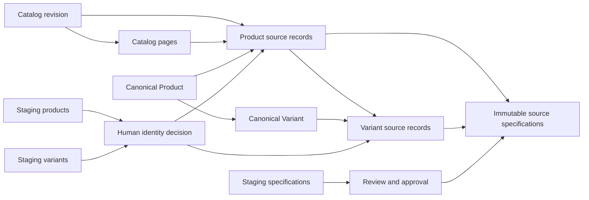
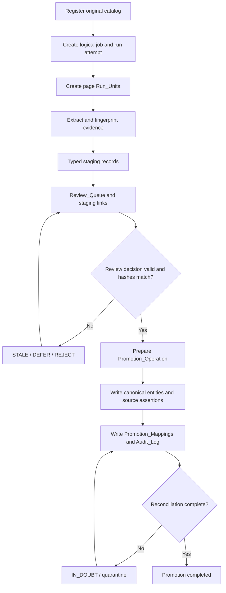
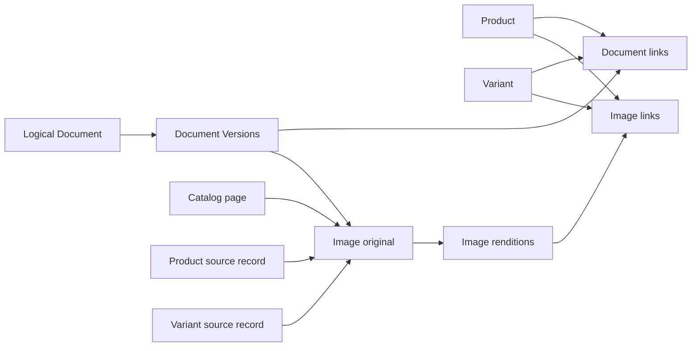
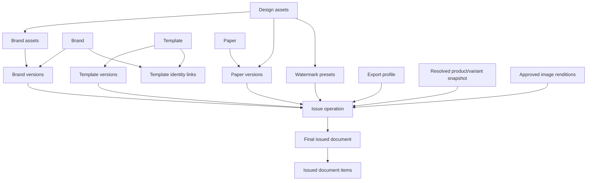

# Data Model Overview — V2.1

**Status:** Conceptual map of the proposed schema. Exact columns and constraints remain in the four domain schema files.

## 1. Supplier source to canonical identity

**Interpretation**
- Catalog and page records identify source evidence.
- Product and Variant rows are canonical internal identities.
- Source records capture each appearance of those identities in a particular supplier catalog revision.
- Specifications point to the exact source occurrence; raw supplier strings are never replaced by normalized values.
- A match decision is required before creating production source records.
- Canonical merge/reparent is excluded from the initial release.

## 2. Workflow and controlled promotion

The worker returns manifests and artifacts; the Apps Script boundary validates them and owns production Sheets writes. Multi-sheet writes are recoverable operations, not assumed transactions.

## 3. Document and image evidence

Document versions retain their own file hash and source provenance. Image originals and renditions have separate immutable IDs and hashes. Product/variant target links are polymorphic and must be validated by a shared resolver.

## 4. Design and issue dependency graph

A final issue is created only after the Issue_Operation completes, the dependency manifest validates, and all Issued_Document_Items reconcile. The exact Paper_Version_ID, design assets, image renditions, data snapshot, renderer fingerprints, preflight report, and final PDF hash are pinned.

## 5. Relationship patterns that require application validation

| Pattern | Validation |
|---|---|
| Canonical Product → Variant | Variant.Product_ID must resolve to one Product. |
| Product_Source_Record → Catalog/Page | Page must belong to the same Catalog revision. |
| Variant_Source_Record → Product_Source_Record | Variant must belong to the canonical Product resolved by the parent source record. |
| Specification → source record | Exactly one source-record FK is populated according to Scope; Product/Variant ownership must match. |
| Review_Staging_Links | Staging_ID must resolve to exactly one typed staging row. |
| Identity_Match_Decisions | Source_Staging_Type/ID and candidate/result canonical ID must resolve to the declared types. |
| Promotion_Mappings | Staging and production polymorphic references must resolve to the declared types. |
| Document_Links / Image_Links | Target type, target ID, ownership, lifecycle, and version/rendition pin must validate. |
| Issued_Document_Items | Variant, if present, must belong to the row's Product_ID. |
| Issue_Operations | Source_Issued_Document_ID, when used for reproduction, must reference a prior completed issue. |

Google Sheets does not enforce these relationships natively. The application validators and integrity scanner are mandatory parts of the design.
